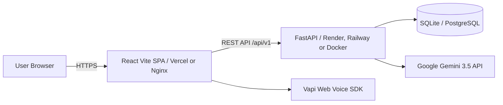

# 🚀 Placement Hub — Production Deployment Guide

This guide covers deployment options for the **Placement Hub** full-stack platform (FastAPI backend + React 19 Vite frontend with Gemini AI & Vapi Voice integration).

---

## 🏗️ Architecture Overview



---

## ⚡ Option 1: Vercel + Render / Railway (Recommended Free & Fast)

### A. Deploy Backend to Render (or Railway)
1. Push your repository to GitHub (`bhumit9744/dypdyp`).
2. Go to [Render Dashboard](https://dashboard.render.com/) → **New Web Service**.
3. Connect your GitHub repository.
4. Configure the service:
   - **Name**: `placement-hub-api`
   - **Root Directory**: `backend`
   - **Runtime**: `Python 3`
   - **Build Command**: `pip install -r requirements.txt`
   - **Start Command**: `uvicorn app.main:app --host 0.0.0.0 --port $PORT`
5. Add Environment Variables in Render:
   | Variable | Value / Description |
   | :--- | :--- |
   | `GEMINI_API_KEY` | Your Google Gemini API Key |
   | `VAPI_PUBLIC_KEY` | `81cda39f-ea88-40b9-862f-bbe1b4fa6abe` |
   | `VAPI_PRIVATE_KEY` | Your Vapi Private Key |
   | `VAPI_ASSISTANT_ID` | `afcf849e-c037-4b2f-960f-6a13fccf2f2e` |
   | `ENVIRONMENT` | `production` |
   | `DATABASE_URL` | `sqlite:///./placement_hub.db` |
6. Click **Deploy**. Note your backend URL (e.g., `https://placement-hub-api.onrender.com`).

---

### B. Deploy Frontend to Vercel
1. Go to [Vercel Dashboard](https://vercel.com/) → **Add New Project**.
2. Import your GitHub repository.
3. Configure the project:
   - **Framework Preset**: `Vite`
   - **Root Directory**: Click edit and select `frontend`
   - **Build Command**: `npm run build`
   - **Output Directory**: `dist`
4. Add Environment Variables in Vercel:
   | Variable | Value |
   | :--- | :--- |
   | `VITE_API_BASE` | `https://placement-hub-api.onrender.com/api/v1` *(replace with your Render backend URL)* |
   | `VITE_VAPI_PUBLIC_KEY` | `81cda39f-ea88-40b9-862f-bbe1b4fa6abe` |
   | `VITE_VAPI_ASSISTANT_ID` | `afcf849e-c037-4b2f-960f-6a13fccf2f2e` |
5. Click **Deploy**!
   *(Note: The included `frontend/vercel.json` automatically handles client-side SPA routing rewrites).*

---

## 🐳 Option 2: Docker Compose (All-in-One VPS / Cloud Server)

To deploy on any Ubuntu/Debian VPS, AWS EC2, or DigitalOcean Droplet:

```bash
# 1. Clone repository on server
git clone https://github.com/bhumit9744/dypdyp.git
cd dypdyp

# 2. Configure backend environment
cp backend/.env.example backend/.env
# Edit backend/.env and add your GEMINI_API_KEY

# 3. Launch with Docker Compose
docker compose up -d --build
```

- **Frontend**: Available on port `http://<SERVER_IP>:3000`
- **Backend API**: Available on port `http://<SERVER_IP>:8000` (docs at `/docs`)

To stop or view logs:
```bash
docker compose logs -f
docker compose down
```

---

## 📋 Environment Variable Reference

### Backend (`backend/.env`)
```ini
ENVIRONMENT=production
DATABASE_URL=sqlite:///./placement_hub.db
GEMINI_API_KEY=your_gemini_api_key_here
GEMINI_MODEL=gemini-3.5-flash-lite
VAPI_PUBLIC_KEY=81cda39f-ea88-40b9-862f-bbe1b4fa6abe
VAPI_PRIVATE_KEY=your_vapi_private_key_here
VAPI_ASSISTANT_ID=afcf849e-c037-4b2f-960f-6a13fccf2f2e
```

### Frontend (`frontend/.env`)
```ini
VITE_API_BASE=https://your-backend-domain.com/api/v1
VITE_VAPI_PUBLIC_KEY=81cda39f-ea88-40b9-862f-bbe1b4fa6abe
VITE_VAPI_ASSISTANT_ID=afcf849e-c037-4b2f-960f-6a13fccf2f2e
```

---

## ✅ Pre-flight Checklist Verified
- [x] All 12 frontend fetch calls centralized through dynamic `VITE_API_BASE`
- [x] `frontend/vercel.json` SPA fallback rewrites configured
- [x] Multi-stage `frontend/Dockerfile` with Nginx Alpine
- [x] Production `backend/Dockerfile` with Uvicorn
- [x] `docker-compose.yml` for unified local/VPS orchestration
- [x] `backend/Procfile` for PaaS deployment
- [x] Frontend builds with 0 TypeScript/compilation errors (`npm run build`)
- [x] Backend database schema auto-migrates missing columns on startup
