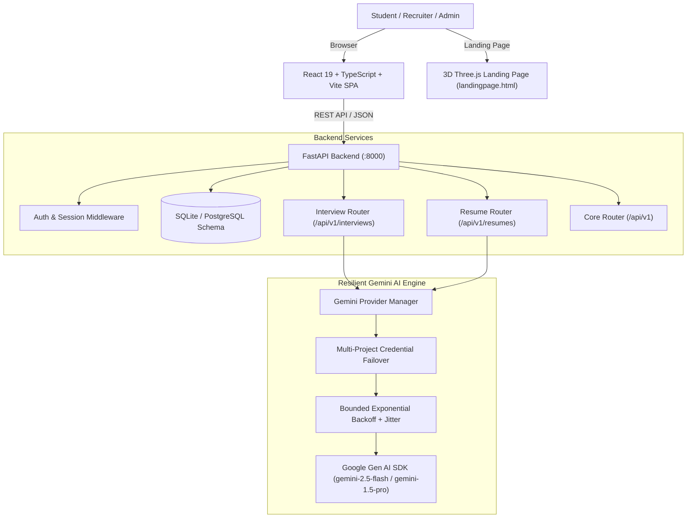

# FLUXX — Forge Your Future
### The All-in-One Placement & Career Acceleration Platform

[](https://python.org)
[](https://fastapi.tiangolo.com)
[](https://react.dev)
[](https://www.typescriptlang.org)
[](https://tailwindcss.com)
[](https://threejs.org)
[](https://ai.google.dev)

> **"From learning to landing, all in one place."**  
> FLUXX bridges the gap between academic preparation and industry hiring. Powered by an enterprise-grade Google Gemini AI engine, an Adobe-inspired Resume Studio, realistic AI Mock Interview simulations, gamified coding arenas, and an end-to-end placement pipeline tracker.

---

## 🌟 Interactive 3D Landing Page (`frontend/landingpage.html`)

FLUXX features a bespoke, production-ready landing page built with modern web aesthetics:

- **Interactive 3D WebGL Canvas**: Powered by Three.js with an ambient particle vortex, dynamic mathematical core geometry, smooth mouse pointer reactivity, and orbit controls.
- **Adaptive Theme System**: Complete token-driven Dark & Light mode switch, respecting OS preferences (`prefers-color-scheme`), with WCAG-compliant color contrast and persistent localStorage state.
- **Interactive AI Interview Lab**: Live simulation preview showcasing real-time question generation, candidate response sandbox, rubric analysis, and structured scoring.
- **Micro-Interactions & Motion**: IntersectionObserver scroll reveals, cursor follower glow, custom toast notification system, and responsive navigation drawer for mobile screens.
- **Direct Contact Channel**: Integrated contact card with direct outreach pathways for students, campus placement cells, and enterprise partners.

To preview the landing page directly:
```bash
# Open frontend/landingpage.html in your default browser:
xdg-open frontend/landingpage.html   # Linux
open frontend/landingpage.html       # macOS
start frontend/landingpage.html      # Windows
```
*Or serve it via Python's built-in HTTP server:*
```bash
python3 -m http.server 3000 --directory frontend
# Open http://localhost:3000/landingpage.html
```

---

## 🚀 Core Platform Pillars

| Pillar | Module | Highlights |
| :--- | :--- | :--- |
| **01 / Guidance** | **Career Coach** | Role gap analysis, tailored skill roadmaps, and competency diagnostics. |
| **02 / Readiness** | **AI Interview Studio** | Realistic behavioral & technical interviews with adaptive Gemini questioning, speech simulation, and instant actionable rubrics. |
| **03 / Discovery** | **Opportunity Explorer** | Curated internships, hackathons, verified full-time listings, and alumni referral networks. |
| **04 / Momentum** | **Placement Pipeline** | Kanban stage tracking (Applied → OA → Technical → HR → Offer), deadline alerts, and compensation benchmarking. |
| **05 / Practice** | **Arena & Games** | Gamified skill grinding with **Algorithm Rush** and **HR Interview Battles**, XP streaks, and campus leaderboards. |
| **06 / Presentation** | **AI Resume Studio** | Adobe-inspired A4 canvas editor with live ATS truth-verification, role tailoring, and PDF export. |

---

## 🏗️ System Architecture



### Key Engineering Highlights:
- **Resilient AI Failover Engine**: Built with the official `google-genai` SDK. Supports multi-project credential rotation, distinct project quota tracking, automatic 429 quota backoff with jitter, transient 503 retry circuits, and zero-leak credential hygiene.
- **Adobe-Inspired Resume Studio**: Document publishing workspace featuring zoomable A4 pagination, typography & margin controls, factual consistency verification, and instant ATS scoring.
- **Full-Stack Type Safety**: Strict TypeScript frontend schemas mirrored in Pydantic models on the backend.

---

## 📁 Repository Structure

```text
dypdyp/
├── backend/
│   ├── app/
│   │   ├── api/               # API endpoints (interviews, resumes, students, etc.)
│   │   ├── core/              # Config, database setup, and security
│   │   ├── models/            # SQLAlchemy database models
│   │   ├── services/          # Gemini failover manager & AI prompt workflows
│   │   └── main.py            # FastAPI entry point & CORS configuration
│   ├── tests/                 # Comprehensive pytest test suite (32 passing tests)
│   └── requirements.txt       # Backend dependencies
├── frontend/
│   ├── landingpage.html       # Standalone 3D Three.js & Dark/Light Landing Page
│   ├── public/                # Static assets, SVG icons, and favicon
│   ├── src/
│   │   ├── components/        # Reusable UI components (Header, Sidebar, Modals)
│   │   ├── context/           # AppContext state management
│   │   ├── pages/             # Dashboard, Career, Explore, Placements, Arena
│   │   ├── types/             # TypeScript interfaces and domain types
│   │   └── App.tsx            # Root application router and layout
│   ├── package.json           # Frontend dependencies (React 19, Tailwind, Lucide)
│   └── vite.config.ts         # Vite build configuration
├── scripts/
│   ├── auto-sync.sh           # Automated Git sync and branch hygiene
│   └── auto-sync.log          # Automated sync audit trail
└── README.md                  # Project documentation
```

---

## ⚡ Quick Start Guide

### 1. Prerequisites
- **Python**: 3.11+
- **Node.js**: 18+ (Node 20+ recommended)
- **Google Gemini API Key(s)**: from [Google AI Studio](https://aistudio.google.com)

---

### 2. Backend Setup

```bash
cd backend

# Create and activate virtual environment
python3 -m venv .venv
source .venv/bin/activate  # On Windows: .venv\Scripts\activate

# Install dependencies
pip install -r requirements.txt

# Configure environment
cp .env.example .env
# Edit .env and supply your GEMINI_API_KEY (or GEMINI_API_KEYS for multi-project failover)

# Run migrations and start API server
uvicorn app.main:app --host 0.0.0.0 --port 8000 --reload
```

Backend will be available at:
- **API Server**: `http://localhost:8000`
- **Interactive Swagger Docs**: `http://localhost:8000/docs`
- **Health Check**: `http://localhost:8000/api/v1/health`

---

### 3. Frontend Setup

```bash
cd frontend

# Install npm dependencies
npm install

# Start Vite development server
npm run dev
```

Frontend application will be accessible at `http://localhost:5173`.

---

### 4. Running the Test Suite

```bash
cd backend
source .venv/bin/activate
pytest tests/ -v
```
*Current test suite: **32/32 unit & integration tests passing** covering core endpoints, interview generation, resume ATS scoring, and Gemini multi-project failover.*

---

## 🎨 Pricing & Tiers (as featured on FLUXX)

- **STARTER** (`Free`): Diagnostic skills audit, basic practice drills, placement pipeline tracker.
- **PRO** (`₹499 / mo` — Featured): Unlimited AI interview simulations, deep diagnostic rubrics, full Resume Studio with ATS export.
- **ELITE** (`₹1,299 / mo`): Priority company matchmaking, alumni mock drives, and tailored interview feedback loops.
- **CAMPUS** (`Institutional`): Cohort-level performance analytics, batch tracking for placement cells, and custom university branding.

---

## 🔐 Security & Privacy
- **Zero API Key Leakage**: API credentials are never sent to the client, logged in output, or returned in error payloads.
- **Safe Sandboxing**: AI interview evaluation runs against isolated prompts with strict validation schemas.
- **Strict Git Protection**: Pre-commit hooks and push sanitization ensure sensitive credentials or tokens are never committed.

---

## 📄 License
This project is developed for educational, recruitment, and placement training acceleration. Built with ❤️ for students forging their future.
